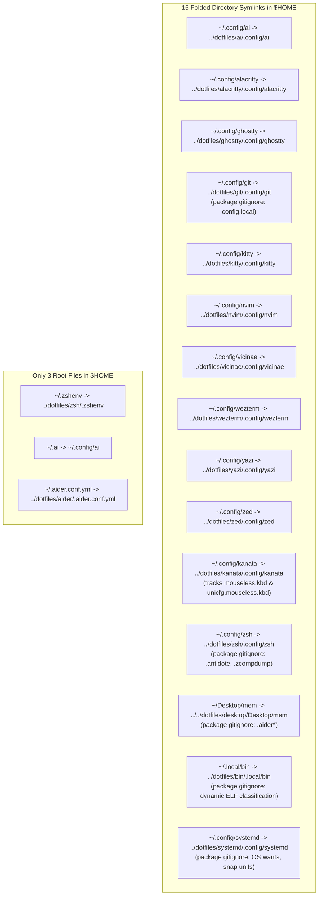

# Implementation Plan: Modular Directory Folding Architecture

## Goal Description
Fold **every configuration directory** (all 15 packages: `systemd`, `git`, `kanata`, `bin`, `zsh`, `desktop/mem`, `nvim`, `wezterm`, `alacritty`, `ghostty`, `kitty`, `vicinae`, `yazi`, `zed`, `ai`) into directory symlinks in `$HOME`.

Enforce **package-local `.gitignore` modularity**:
- **Root `.gitignore`**: Contains **only universal rules** (secrets, private keys, binary extensions `*.so`/`*.exe`, OS junk `.DS_Store`). **Zero package-specific paths**.
- **Package-local `.gitignore` files**: Each package encapsulates its own exclusions:
  - `systemd/.config/systemd/.gitignore`: OS target wants, snap units, and machine-generated `ai-memory.service`.
  - `git/.config/git/.gitignore`: Local machine credentials (`config.local`, `credentials*`).
  - `zsh/.config/zsh/.gitignore`: Runtime caches (`.antidote/`, `.zcompdump*`, `.zsh_plugins.zsh*`).
  - `bin/.local/bin/.gitignore`: Dynamic file-type classified ELF binaries.
  - `kanata/.config/kanata/.gitignore`: Editor artifacts (`.kilo/`, `*.old`).
  - `desktop/Desktop/mem/.gitignore`: Local chat histories (`.aider*`).



---

## User Review Required

> [!IMPORTANT]
> - **Package-Local `.gitignore` Architecture**: The root `~/dotfiles/.gitignore` contains **no package-specific rules**. Exclusions for `systemd`, `git`, `zsh`, `bin`, `kanata`, and `desktop` are fully contained within their respective package directories.
> - **Tracked User Systemd Files**:
>   - `vicinae.service.d/override.conf` is **tracked in Git**.
>   - `timers.target.wants/backup-atuin-history.timer` and `timers.target.wants/ai-agents-history-import.timer` are **tracked in Git**.
> - **Kanata Mouseless Tracked**: `mouseless.kbd` and `unicfg.mouseless.kbd` are tracked in Git.
> - **Local Bin**: Zero wildcard ignore rules; user scripts tracked by default; dynamic ELF binary classification (< 2 ms) for compiled tools.

---

## Proposed Changes

### Component 1: Universal Root Gitignore (No Package Paths)

#### [MODIFY] `~/dotfiles/.gitignore`
```gitignore
# ==============================================================================
# Universal Dotfiles Repository Git Exclusion Rules
# (Package-specific rules are isolated inside package-local .gitignore files)
# ==============================================================================

# Universal Git repository exclusion
**/.git/**

# Secrets & private keys (never track)
.ssh/id_*
.ssh/*.pem
.ssh/*.key
**/.ssh/id_*
**/.ssh/*.pem
**/.ssh/*.key
**/*.key
**/*.pem
**/*.p12
**/*.pfx
**/*.secret
**/.env
**/.env.*
!**/.env.example

# Universal binary filtering (compiled binaries & libraries anywhere)
*.exe
*.bin
*.so
*.so.*
*.dylib
*.dll
*.o
*.a
*.pyc
**/__pycache__/**

# Universal runtime caches & volatile dumps
**/node_modules/**
**/.DS_Store
**/Thumbs.db
**/*.bak
**/*.swp
**/*.swo
**/.nvimlog
*~
.cache/
.stow-local-ignore
```

---

### Component 2: `systemd` Package (`~/.config/systemd`)

#### [NEW] `systemd/.config/systemd/.gitignore`
```gitignore
# OS-managed target wants and snap units
user/default.target.wants/
user/graphical-session.target.wants/
user/ai-memory.service
**/snap.*
```

#### [EXECUTE] Folding `~/.config/systemd`
1. Move tracked user files and OS files into `~/dotfiles/systemd/.config/systemd/user/`:
   ```bash
   mkdir -p "$HOME/dotfiles/systemd/.config/systemd/user/timers.target.wants"
   mkdir -p "$HOME/dotfiles/systemd/.config/systemd/user/vicinae.service.d"
   
   # Move user-created items:
   cp -a "$HOME/.config/systemd/user/vicinae.service.d/override.conf" "$HOME/dotfiles/systemd/.config/systemd/user/vicinae.service.d/"
   cp -a "$HOME/.config/systemd/user/timers.target.wants/backup-atuin-history.timer" "$HOME/dotfiles/systemd/.config/systemd/user/timers.target.wants/"
   cp -a "$HOME/.config/systemd/user/timers.target.wants/ai-agents-history-import.timer" "$HOME/dotfiles/systemd/.config/systemd/user/timers.target.wants/"
   
   # Move OS runtime folders:
   mv "$HOME/.config/systemd/user/default.target.wants" "$HOME/dotfiles/systemd/.config/systemd/user/"
   mv "$HOME/.config/systemd/user/graphical-session.target.wants" "$HOME/dotfiles/systemd/.config/systemd/user/"
   mv "$HOME/.config/systemd/user/timers.target.wants"/* "$HOME/dotfiles/systemd/.config/systemd/user/timers.target.wants/" 2>/dev/null || true
   mv "$HOME/.config/systemd/user/ai-memory.service" "$HOME/dotfiles/systemd/.config/systemd/user/" 2>/dev/null || true
   ```
2. Unstow `systemd`, remove existing directory `~/.config/systemd`:
   ```bash
   stow -D -t "$HOME" -d "$HOME/dotfiles" systemd
   rm -rf "$HOME/.config/systemd"
   ```
3. Stow `systemd` as a directory symlink:
   ```bash
   stow -v -t "$HOME" -d "$HOME/dotfiles" systemd
   # LINK: .config/systemd => ../dotfiles/systemd/.config/systemd
   ```
4. Stage user-created systemd files in Git:
   ```bash
   git -C ~/dotfiles add systemd/.config/systemd/user/vicinae.service.d/override.conf \
                         systemd/.config/systemd/user/timers.target.wants/backup-atuin-history.timer \
                         systemd/.config/systemd/user/timers.target.wants/ai-agents-history-import.timer
   ```

---

### Component 3: `git` Package (`~/.config/git`)

#### [NEW] `git/.config/git/.gitignore`
```gitignore
# Machine-local Git credentials & sensitive files
config.local
*.local
credentials*
*.secret
```

#### [VERIFY] Folded State & Protection
- `~/.config/git -> ../dotfiles/git/.config/git` verified as active directory symlink.
- `config.local` is ignored via `git/.config/git/.gitignore`.

---

### Component 4: `kanata` Package (`~/.config/kanata`)

#### [NEW] `kanata/.config/kanata/.gitignore`
```gitignore
.kilo/
*.old
```

#### [EXECUTE] Folding `~/.config/kanata`
1. Move `mouseless.kbd`, `unicfg.mouseless.kbd`, and `config.kbd.old` to `~/dotfiles/kanata/.config/kanata/`.
2. Trash orphaned `~/.config/kanata/.git` and `~/.config/kanata/.kilo` via `gio trash`.
3. Fold directory:
   ```bash
   stow -D -t "$HOME" -d "$HOME/dotfiles" kanata
   rmdir "$HOME/.config/kanata"
   stow -v -t "$HOME" -d "$HOME/dotfiles" kanata
   ```
4. Track mouseless configs:
   ```bash
   git -C ~/dotfiles add kanata/.config/kanata/mouseless.kbd kanata/.config/kanata/unicfg.mouseless.kbd
   ```

---

### Component 5: `bin` Package (`~/.local/bin`)

#### [NEW] `scripts/classify-binaries.sh`
Dynamic classifier script that detects ELF binaries (`\x7fELF`) and external symlinks, writing auto-detected ignores directly to `bin/.local/bin/.gitignore`.

#### [EXECUTE] Folding `~/.local/bin`
1. Add `classify-binaries.sh` execution to `bin/.local/bin/dotfiles` (`status`, `apply`, `push`), `.githooks/pre-commit`, and `setup.sh`.
2. Move `mise`, `uv`, `uvx`, `obsidian`, and external symlinks to `~/dotfiles/bin/.local/bin/`.
3. Trash `scripts/` (backed up) and `__pycache__/`.
4. Run `classify-binaries.sh`.
5. Fold directory:
   ```bash
   stow -D -t "$HOME" -d "$HOME/dotfiles" bin
   rmdir "$HOME/.local/bin"
   stow -v -t "$HOME" -d "$HOME/dotfiles" bin
   ```

---

### Component 6: `zsh` & `desktop` Packages

#### [NEW] `desktop/Desktop/mem/.gitignore`
```gitignore
.aider*
```

#### [MODIFY] `zsh/.config/zsh/.gitignore`
```gitignore
.antidote/
.zcompdump*
.zsh_plugins.zsh*
*.bak
```

#### [EXECUTE] Folding `~/.config/zsh` & `~/Desktop/mem`
1. `~/.config/zsh`: Move `.antidote/`, `.zcompdump*`, `.zsh_plugins.zsh*` to `~/dotfiles/zsh/.config/zsh/`, trash orphaned `.git` and `*.bak`, unstow, `rmdir ~/.config/zsh`, and stow `zsh`.
2. `~/Desktop/mem`: Move `.aider*` to `~/dotfiles/desktop/Desktop/mem/`, unstow, `rmdir ~/Desktop/mem`, and stow `desktop`.

---

## Verification Plan

### Automated Tests
Run this complete test suite post-execution:
```bash
python3 -c '
import os, subprocess

# 1. Verify ALL 15 folded directories
folded_dirs = [
    "~/.config/ai", "~/.config/alacritty", "~/.config/ghostty", "~/.config/git",
    "~/.config/kanata", "~/.config/kitty", "~/.config/nvim", "~/.config/systemd",
    "~/.config/vicinae", "~/.config/wezterm", "~/.config/yazi", "~/.config/zed",
    "~/.config/zsh", "~/.local/bin", "~/Desktop/mem"
]
for d in folded_dirs:
    p = os.path.expanduser(d)
    assert os.path.islink(p) and os.path.isdir(p), f"Directory symlink failed: {d}"

# 2. Verify root file links
for f in ["~/.zshenv", "~/.ai", "~/.aider.conf.yml"]:
    p = os.path.expanduser(f)
    assert os.path.islink(p), f"Root link failed: {f}"

# 3. Verify user-created systemd files are tracked
tracked_systemd = subprocess.check_output(["git", "-C", os.path.expanduser("~/dotfiles"), "ls-files", "systemd/.config/systemd/user"]).decode()
assert "vicinae.service.d/override.conf" in tracked_systemd, "vicinae override.conf not tracked!"
assert "timers.target.wants/backup-atuin-history.timer" in tracked_systemd, "backup-atuin-history timer link not tracked!"
assert "backup-atuin-history.service" in tracked_systemd, "backup-atuin-history service not tracked!"

# 4. Verify OS systemd files are ignored via package-local gitignore
status = subprocess.check_output(["git", "-C", os.path.expanduser("~/dotfiles"), "status", "-s"]).decode()
assert "snap." not in status, "Snap files leaked into Git"
assert "default.target.wants" not in status, "default.target.wants leaked into Git"
assert "graphical-session.target.wants" not in status, "graphical-session.target.wants leaked into Git"
assert "ai-memory.service" not in status, "ai-memory.service leaked into Git"

# 5. Verify Git sensitive info protection via package-local gitignore
assert "config.local" not in status, "Sensitive git credentials leaked into Git"

# 6. Verify Kanata mouseless tracking
kanata_files = subprocess.check_output(["git", "-C", os.path.expanduser("~/dotfiles"), "ls-files", "kanata/.config/kanata"]).decode()
assert "mouseless.kbd" in kanata_files and "unicfg.mouseless.kbd" in kanata_files, "Kanata mouseless not tracked"

# 7. Verify local/bin script auto-tracking
test_script = os.path.expanduser("~/.local/bin/__test_script__.sh")
with open(test_script, "w") as f: f.write("#!/bin/sh\necho test\n")
status_after = subprocess.check_output(["git", "-C", os.path.expanduser("~/dotfiles"), "status", "-s"]).decode()
os.remove(test_script)
assert "__test_script__.sh" in status_after, "New script not detected by Git"

print("ALL 15 FOLDED DIRECTORIES AND MODULAR GITIGNORES VERIFIED!")
'
```

### Operational & Audit Verification
```bash
systemctl --user list-timers --all | grep atuin  # Verify systemd timer resolves and runs
git -C ~/dotfiles status -s                      # Working tree clean
dotfiles audit                                   # Gitleaks: 0 leaks
```
