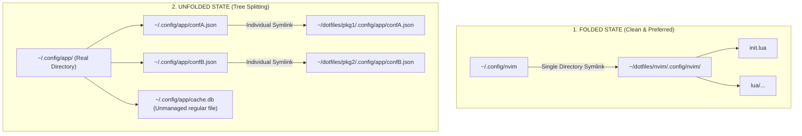

# 📖 GNU Stow Complete Usage Guide & Scenario Handbook

A comprehensive, scenario-driven operational manual for managing dotfiles with [GNU Stow](https://www.gnu.org/software/stow/). This guide covers all everyday workflows, structural architectures, edge cases, failure modes, and recovery protocols.

---

## 📑 Table of Contents

1. [Core Mental Model & How Stow Works](#1-core-mental-model--how-stow-works)
2. [Directory Folding vs. Tree Unfolding](#2-directory-folding-vs-tree-unfolding)
3. [Scenario Matrix: Adding & Tracking Files](#3-scenario-matrix-adding--tracking-files)
   - [3.1 Adding a File to a Folded Package](#31-adding-a-file-to-a-folded-package)
   - [3.2 Adding a File to an Unfolded Package](#32-adding-a-file-to-an-unfolded-package)
   - [3.3 Adding an Entirely New Modular Package](#33-adding-an-entirely-new-modular-package)
   - [3.4 Adding Deeply Nested Subdirectories](#34-adding-deeply-nested-subdirectories)
   - [3.5 Managing Files with Special Names or Leading Dots](#35-managing-files-with-special-names-or-leading-dots)
4. [Scenario Matrix: Managed vs. Unmanaged Files & Collisions](#4-scenario-matrix-managed-vs-unmanaged-files--collisions)
   - [4.1 Collision with Pre-Existing Unmanaged Files](#41-collision-with-pre-existing-unmanaged-files)
   - [4.2 The `--adopt` Flag: The Double-Edged Sword](#42-the---adopt-flag-the-double-edged-sword)
   - [4.3 Pre-Existing Unmanaged Directory Blocking a Folded Symlink](#43-pre-existing-unmanaged-directory-blocking-a-folded-symlink)
   - [4.4 Unmanaged Files Generated by Applications at Runtime](#44-unmanaged-files-generated-by-applications-at-runtime)
   - [4.5 Dynamic File Classification (ELF Binaries & External Symlinks)](#45-dynamic-file-classification-elf-binaries--external-symlinks)
5. [Scenario Matrix: Modifying, Renaming, and Deleting Files](#5-scenario-matrix-modifying-renaming-and-deleting-files)
   - [5.1 Modifying Tracked Files & Editor Atomic Saves](#51-modifying-tracked-files--editor-atomic-saves)
   - [5.2 Deleting Tracked Files & The Dangling Symlink Trap](#52-deleting-tracked-files--the-dangling-symlink-trap)
   - [5.3 Renaming or Moving Tracked Files](#53-renaming-or-moving-tracked-files)
   - [5.4 Unstowing / Removing an Entire Package](#54-unstowing--removing-an-entire-package)
6. [Scenario Matrix: Multi-Package Interactions & Conflicts](#6-scenario-matrix-multi-package-interactions--conflicts)
   - [6.1 Direct Path Collisions Between Two Packages](#61-direct-path-collisions-between-two-packages)
   - [6.2 Cross-Package Directory Sharing & Dynamic Folding/Unfolding](#62-cross-package-directory-sharing--dynamic-foldingunfolding)
   - [6.3 Overrides and Deferrals (`--override` & `--defer`)](#63-overrides-and-deferrals---override----defer)
7. [Scenario Matrix: Ignore Rules & Regex Gotchas](#7-scenario-matrix-ignore-rules--regex-gotchas)
   - [7.1 `.stow-local-ignore` vs. `.stow-global-ignore`](#71-stow-local-ignore-vs-stow-global-ignore)
   - [7.2 The Perl Regex Gotcha (Shell Globs Do NOT Work)](#72-the-perl-regex-gotcha-shell-globs-do-not-work)
   - [7.3 Built-in Default Ignore Patterns](#73-built-in-default-ignore-patterns)
8. [Scenario Matrix: Invocation, Target & Path Hazards](#8-scenario-matrix-invocation-target--path-hazards)
   - [8.1 The "Wrong Directory" Invocation Trap (Target Defaulting)](#81-the-wrong-directory-invocation-trap-target-defaulting)
   - [8.2 Symlink Loops and Circular References](#82-symlink-loops-and-circular-references)
   - [8.3 Permissions, Sudo, and Multi-User Environments](#83-permissions-sudo-and-multi-user-environments)
9. [Scenario Matrix: Machine Bootstrapping & Multi-OS Portability](#9-scenario-matrix-machine-bootstrapping--multi-os-portability)
   - [9.1 Fresh Distro Skeleton Collisions (`/etc/skel`)](#91-fresh-distro-skeleton-collisions-etcskel)
   - [9.2 Machine-Local Credentials & Sensitive Files](#92-machine-local-credentials--sensitive-files)
   - [9.3 Cross-Platform Path Quirks (Linux vs. macOS)](#93-cross-platform-path-quirks-linux-vs-macos)
10. [Diagnostic Workflow & Error Catalog](#10-diagnostic-workflow--error-catalog)
11. [Command Quick Reference Cheat Sheet](#11-command-quick-reference-cheat-sheet)

---

## 1. Core Mental Model & How Stow Works

GNU Stow is a **symlink farm manager**. It does not copy, merge, template, or sync files. It creates relative symlinks pointing from a target tree (typically `$HOME`) back to source files organized inside package directories inside a stow directory (`~/dotfiles/<package>`).

```text
Stow Directory (-d): ~/dotfiles/
Target Directory (-t): /home/dj/ ($HOME)

Package: nvim/
  └── .config/
      └── nvim/
          └── init.lua

Resulting Target Link:
~/.config/nvim  -->  ../dotfiles/nvim/.config/nvim  (Directory Folded)
```

### The Invariant: Relative Symlink Computation
Stow computes relative paths from the target directory to the source file. If your target is `$HOME` and stow directory is `$HOME/dotfiles`, a file at `~/dotfiles/zsh/.zshenv` is symlinked as:
```text
~/.zshenv -> dotfiles/zsh/.zshenv
```
A file at `~/dotfiles/bin/.local/bin/dotfiles` is symlinked as:
```text
~/.local/bin/dotfiles -> ../../dotfiles/bin/.local/bin/dotfiles
```

### Core CLI Flags
| Flag | Name | Meaning |
| :--- | :--- | :--- |
| `-d DIR` | `--dir=DIR` | Set source stow directory (defaults to current working directory) |
| `-t DIR` | `--target=DIR` | Set target directory (defaults to parent directory `..`) |
| `-S` | `--stow` | Install symlinks for specified packages (default operation) |
| `-D` | `--delete` | Remove symlinks for specified packages (unstow) |
| `-R` | `--restow` | Restow packages (re-evaluates links; equivalent to `-D` followed by `-S`) |
| `--adopt` | *(caution)* | Absorb existing target files into the package, overwriting repo content |
| `-n` | `--no`, `--simulate` | Dry-run mode; reports planned actions without altering disk |
| `-v` | `--verbose[=N]` | Verbose logging (levels 0–5; `-v`, `-vv`, `-vvv`) |
| `--dotfiles` | | Enables `dot-` filename translation (`dot-bashrc` -> `.bashrc`) |

> [!IMPORTANT]
> **Always supply `-t "$HOME" -d "$DOTFILES_DIR"`** in shell scripts and manual invocations. Never rely on current working directory defaults.

---

## 2. Directory Folding vs. Tree Unfolding

Directory folding is Stow's most powerful feature and the single largest source of confusion for users.



### What is Directory Folding?
When a target directory does not yet exist in `$HOME` (or only contains files belonging to a single package), Stow symlinks the **entire directory** at the highest possible level.
- **Example**: `~/.config/nvim` is symlinked directly to `../dotfiles/nvim/.config/nvim`.
- **Advantage**: Clean `$HOME`, zero file-level symlink clutter, instant performance, and newly added files in the repo are immediately visible without running Stow again.

### What is Tree Unfolding?
When Stow is forced to break a directory symlink into a real directory containing individual file symlinks.
Stow unfolds when:
1. **Multiple packages share a directory**: Package A has `.config/tool/a.conf` and Package B has `.config/tool/b.conf`.
2. **An unmanaged regular file or directory exists** in the target location before stowing.
3. **An external application creates an unmanaged file** inside a directory where Stow expected exclusive control.

### What is Re-Folding?
If the conditions causing an unfold are eliminated (e.g., conflicting files or second package removed), running `stow -R <pkg>` will automatically delete the real directory and restore the single directory-level symlink.

---

### ⚠️ The Folded Directory Trap (Runtime Application Noise)

> [!WARNING]
> If `~/.config/app` is a **folded directory symlink** pointing into `~/dotfiles/app/.config/app`, any file created by that application at runtime (caches, socket files, history, sqlite databases, log files) is **written directly into your dotfiles Git repository**!

#### Real-World Case Study 1: `~/.local/bin` and Dynamic Binaries
- `~/.local/bin` is folded to `~/dotfiles/bin/.local/bin`.
- Tools like `cargo install`, `pipx`, `go install`, or system packages write compiled ELF binaries directly into `~/.local/bin`.
- **Result**: `git status` suddenly flags large binary executables inside your dotfiles repo.
- **Solution in this repo**: The dynamic classifier [`scripts/classify-binaries.sh`](file:///home/dj/dotfiles/scripts/classify-binaries.sh) detects compiled ELF files (`\x7fELF`) and unmanaged external symlinks, auto-generating a package-local `bin/.local/bin/.gitignore`.

#### Real-World Case Study 2: Runtime Caches and Editor State
- `systemd` creates OS target wants (`default.target.wants/`).
- `zsh` generates `.zcompdump` and Antidote downloads plugins to `.antidote/`.
- `desktop/Desktop/mem` accumulates local chat logs (`.aider*`).
- **Solution in this repo**: **Package-Local `.gitignore` Architecture**. Every package isolates its own runtime noise locally without polluting the global repo `.gitignore`.

---

## 3. Scenario Matrix: Adding & Tracking Files

### 3.1 Adding a File to a Folded Package
**Scenario**: You want to add a new snippet or config file to a package whose parent directory is already folded (e.g., `nvim`, `ghostty`, `kitty`, `zed`).

* **Behavior**:
  Because `~/.config/nvim` is already a symlink pointing directly to `~/dotfiles/nvim/.config/nvim`, editing or creating `~/.config/nvim/lua/plugins/new.lua` immediately creates the file inside `~/dotfiles/nvim/.config/nvim/lua/plugins/new.lua`.
* **Action Required**:
  ```bash
  # 1. Edit or create the file from anywhere:
  nvim ~/.config/nvim/lua/plugins/new.lua
  # (or edit directly in ~/dotfiles/nvim/.config/nvim/lua/plugins/new.lua)

  # 2. No restow is required! Just check git:
  dotfiles status
  git -C ~/dotfiles add nvim/.config/nvim/lua/plugins/new.lua
  git -C ~/dotfiles commit -m "feat(nvim): add new plugin config"
  ```
* **Gotcha**: Verify that the file does not contain private tokens or secrets. Check package-local `.gitignore` if the file is generated by a tool.

---

### 3.2 Adding a File to an Unfolded Package
**Scenario**: You have an unfolded package (e.g., loose files in `$HOME` like `~/.zshenv` or `~/.aider.conf.yml`, or an unfolded directory), and you want to track a new file.

* **Behavior**:
  Creating `~/.newconfig` directly in `$HOME` creates a regular unmanaged file. Stow knows nothing about it.
* **Standard Resolution Steps**:
  ```bash
  # Step 1: Move the new file into the target package inside ~/dotfiles
  mkdir -p ~/dotfiles/mypkg/
  mv ~/.newconfig ~/dotfiles/mypkg/.newconfig

  # Step 2: Restow the package to link it back to $HOME
  stow -v -R -t "$HOME" -d ~/dotfiles mypkg

  # Step 3: Verify the symlink
  ls -l ~/.newconfig
  # Output: ~/.newconfig -> dotfiles/mypkg/.newconfig
  ```

---

### 3.3 Adding an Entirely New Modular Package
**Scenario**: You installed a new tool (e.g., `starship` or `tmux`) and want to manage its configuration in `~/dotfiles`.

* **Step-by-Step Procedure**:
  ```bash
  # 1. Create package directory structure mirroring $HOME
  mkdir -p ~/dotfiles/starship/.config

  # 2. Move existing config into the package
  mv ~/.config/starship.toml ~/dotfiles/starship/.config/starship.toml

  # 3. Simulate first to ensure no conflicts
  stow -n -v -t "$HOME" -d ~/dotfiles starship

  # 4. Stow the package
  stow -v -t "$HOME" -d ~/dotfiles starship

  # 5. Register in setup.sh PACKAGES array so it restows automatically:
  # Edit setup.sh and add 'starship' to PACKAGES=(...)

  # 6. Commit the new package
  git -C ~/dotfiles add starship/ setup.sh
  git -C ~/dotfiles commit -m "feat: add starship package"
  ```

---

### 3.4 Adding Deeply Nested Subdirectories
**Scenario**: A tool expects configurations in `~/.config/tool/sub/dir/config.json`.

* **Behavior**:
  Stow mirrors intermediate directories automatically. If `~/.config/tool` is folded, the entire tree lives in your repo. If unfolded, Stow creates missing directories in `$HOME` and symlinks the file at the leaf.
* **Gotcha**: Do not manually `mkdir -p ~/.config/tool` in `$HOME` prior to stowing. Let Stow handle directory creation so it can fold the entire tree if possible.

---

### 3.5 Managing Files with Special Names or Leading Dots
**Scenario**: Working with tools that don't allow dotfiles in repo browsers, or systems where hidden files in repo cause issues.

* **Using `--dotfiles` mode**:
  If Stow is run with `--dotfiles`, it translates files named `dot-foo` in the package to `.foo` in the target:
  ```text
  ~/dotfiles/bash/dot-bashrc  -->  ~/.bashrc
  ```
* **Gotcha**: This dotfiles repository uses standard dot prefixes (e.g. `.zshenv`, `.config/`). Do not mix `dot-` naming unless explicitly using the `--dotfiles` flag.

---

## 4. Scenario Matrix: Managed vs. Unmanaged Files & Collisions

### 4.1 Collision with Pre-Existing Unmanaged Files
**Error Message**:
```text
* existing target is neither a link nor a directory: .config/foo/config.json
```
* **Root Cause**:
  A regular, unmanaged file already exists in `$HOME/.config/foo/config.json` where Stow wants to place a symlink. Stow strictly refuses to overwrite existing files to prevent data loss.
* **How to Deal With It (Safe Resolution)**:
  ```bash
  # 1. Back up the conflicting unmanaged file
  mkdir -p ~/.cache/dotfiles/backups/
  mv ~/.config/foo/config.json ~/.cache/dotfiles/backups/config.json.bak

  # 2. Re-stow the package
  stow -v -R -t "$HOME" -d ~/dotfiles foo

  # 3. Compare backup with repo version to merge any local tweaks
  diff -u ~/.cache/dotfiles/backups/config.json.bak ~/.config/foo/config.json
  ```
* **Automated Solution**:
  The repository's [`setup.sh`](file:///home/dj/dotfiles/setup.sh) contains an automatic backup handler (`backup_conflicts`) that sweeps target files before stowing and moves conflicting regular files to `~/.cache/dotfiles/backups/<timestamp>/`.

---

### 4.2 The `--adopt` Flag: The Double-Edged Sword

Stow provides `--adopt` to import existing target files into the package repository.

> [!CAUTION]
> `--adopt` works by **moving the existing target file into your Stow package**, overwriting the file in your repository!
> If `$HOME` contains an empty, default, or corrupt configuration file generated by a fresh OS install, running `stow --adopt` will **destroy your curated repository config** with the target file!

```text
Target File in $HOME (unmanaged/distro default)
            │
            ▼  stow --adopt
Source File in ~/dotfiles/ (OVERWRITTEN!)
```

#### Safe Protocol for Using `--adopt`
Never use `--adopt` without this strict 5-step safety check:

```bash
# Step 1: Ensure Git repository working tree is 100% clean
git -C ~/dotfiles status
# If not clean: commit or stash changes first!

# Step 2: Run adopt in simulation mode first
stow -n -v --adopt -t "$HOME" -d ~/dotfiles <pkg>

# Step 3: Run adopt
stow -v --adopt -t "$HOME" -d ~/dotfiles <pkg>

# Step 4: Immediately inspect git diff to see what was overwritten
git -C ~/dotfiles diff

# Step 5: Choose what to keep:
# - If target file had changes you want: git add and commit
# - If target file was unwanted distro junk: git restore .
# Then re-stow cleanly:
stow -v -R -t "$HOME" -d ~/dotfiles <pkg>
```

---

### 4.3 Pre-Existing Unmanaged Directory Blocking a Folded Symlink
**Scenario**: You want `~/.config/kitty` to be a folded directory symlink, but an unmanaged directory `~/.config/kitty/` already exists in `$HOME`.

* **Behavior**:
  Stow will not delete the directory. Instead, it unfolds into tree mode, placing individual symlinks inside `~/.config/kitty/`.
* **Resolution to Restore Clean Folding**:
  ```bash
  # 1. Unstow kitty package
  stow -v -D -t "$HOME" -d ~/dotfiles kitty

  # 2. Check for unmanaged files in target directory
  ls -la ~/.config/kitty

  # 3. If empty or backed up, remove the real directory:
  rmdir ~/.config/kitty   # (or trash-put ~/.config/kitty if it has unmanaged files)

  # 4. Stow kitty cleanly:
  stow -v -t "$HOME" -d ~/dotfiles kitty

  # 5. Verify it is now a single folded symlink:
  ls -ld ~/.config/kitty
  # ~/.config/kitty -> ../dotfiles/kitty/.config/kitty
  ```

---

### 4.4 Unmanaged Files Generated by Applications at Runtime
**Scenario**: An application creates a cache or state file inside a directory managed by Stow.

* **In a Folded Directory (`~/.config/app -> ~/dotfiles/app/.config/app`)**:
  - The runtime file appears inside `~/dotfiles/app/.config/app/runtime.db`.
  - **Fix**: Add `runtime.db` to `~/dotfiles/app/.config/app/.gitignore`.
  - **Do NOT** put it in the root `~/dotfiles/.gitignore` (keep packages self-contained).

* **In an Unfolded Directory**:
  - The runtime file sits in the real directory `~/.config/app/runtime.db` as a regular file.
  - Stow ignores it during restow, provided its name does not collide with a file in the package.

---

### 4.5 Dynamic File Classification (ELF Binaries & External Symlinks)
**Scenario**: You fold `~/.local/bin` to `~/dotfiles/bin/.local/bin`. Any binary downloaded by `curl`, `pipx`, or package managers lands in your git repo.

* **How this repository solves it**:
  [`scripts/classify-binaries.sh`](file:///home/dj/dotfiles/scripts/classify-binaries.sh) inspects every file in `bin/.local/bin`:
  1. Checks file header for ELF magic bytes (`\x7fELF`) -> dynamically ignores it.
  2. Checks symlinks with `readlink` -> if it points outside `~/dotfiles`, dynamically ignores it.
  3. Writes ignores to `bin/.local/bin/.gitignore`.
  4. Keeps all your custom shell scripts tracked automatically.

---

## 5. Scenario Matrix: Modifying, Renaming, and Deleting Files

### 5.1 Modifying Tracked Files & Editor Atomic Saves
**Scenario**: You edit a symlinked file in Vim, Neovim, or another editor.

* **Gotcha: Breaking Symlinks via Inode Replacement**:
  Some text editors use "atomic writes" by writing a new file to a temporary inode and renaming it over the destination. If an editor does this on a symlink, it **destroys the symlink and replaces it with a regular file**, decoupling it from Git!
* **How to Prevent**:
  - In Neovim / Vim: Ensure `set backupcopy=yes` is set (LazyVim and this repo configure this properly).
  - In VS Code / Zed: Editors follow symlinks by default.

---

### 5.2 Deleting Tracked Files & The Dangling Symlink Trap
**Scenario**: You want to remove a file from a package.

> [!WARNING]
> If you delete a file from `~/dotfiles/pkg/` while the package is still stowed, the target link in `$HOME` becomes a **broken / dangling symlink**!
> Worse: Running `stow -D pkg` *after* deleting the file from the repo will warn:
> `WARNING: in unstow for package pkg: target ... does not exist`
> Stow cannot clean up the symlink because the source is already gone!

* **Proper Deletion Sequence**:
  ```bash
  # Step 1: Remove the symlink first using Stow (or unstow package)
  stow -v -D -t "$HOME" -d ~/dotfiles <pkg>

  # Step 2: Delete the file from the repository
  git -C ~/dotfiles rm <pkg>/.config/path/to/file

  # Step 3: Re-stow the remaining package files
  stow -v -t "$HOME" -d ~/dotfiles <pkg>
  ```

* **If you already deleted the source file and have dangling symlinks**:
  ```bash
  # Find all broken symlinks in $HOME pointing to dotfiles:
  find "$HOME" -maxdepth 3 -xtype l -exec ls -l {} +

  # Remove specific broken symlink:
  trash-put ~/.config/path/to/dangling_link   # or rm ~/.config/path/to/dangling_link

  # Re-stow:
  dotfiles apply
  ```

---

### 5.3 Renaming or Moving Tracked Files
**Scenario**: Renaming `config.yaml` to `config.yml` inside a package.

* **Procedure**:
  ```bash
  # 1. Restow handles renames cleanly if done via -R:
  git -C ~/dotfiles mv <pkg>/.config/tool/config.yaml <pkg>/.config/tool/config.yml
  stow -v -R -t "$HOME" -d ~/dotfiles <pkg>

  # 2. Verify target reflects the new name and old symlink is gone:
  ls -l ~/.config/tool/
  ```

---

### 5.4 Unstowing / Removing an Entire Package
**Scenario**: You uninstalled `yazi` or `alacritty` and want to remove its dotfiles from `$HOME`.

* **Procedure**:
  ```bash
  # 1. Unstow the package
  stow -v -D -t "$HOME" -d ~/dotfiles yazi

  # 2. Stow automatically removes any empty parent directories it created.
  # If yazi had unmanaged runtime files inside it, Stow leaves the unmanaged files intact.
  ```

---

## 6. Scenario Matrix: Multi-Package Interactions & Conflicts

### 6.1 Direct Path Collisions Between Two Packages
**Error Message**:
```text
* existing target is neither a link nor a directory: .config/starship.toml
  or
* conflicts with existing link
```
* **Root Cause**:
  Package A and Package B both define a file at the exact same relative target path (e.g. `zsh/.config/starship.toml` and `starship/.config/starship.toml`).
* **Rule**: Two packages cannot own the same leaf file.
* **Resolution**: Consolidate the file into one dedicated package. Remove it from the other.

---

### 6.2 Cross-Package Directory Sharing & Dynamic Folding/Unfolding
**Scenario**: Package `git` defines `git/.config/git/config`, while Package `nvim` defines `nvim/.config/nvim/init.lua`.

* **How Stow Handles Shared Parents**:
  - `~/.config` is created as a real directory in `$HOME` (unfolded).
  - Inside `~/.config`, both `git` and `nvim` remain neatly folded directory symlinks:
    - `~/.config/git -> ../dotfiles/git/.config/git`
    - `~/.config/nvim -> ../dotfiles/nvim/.config/nvim`
* **What happens if two packages share a leaf directory?**:
  - Package A: `~/.config/shared/a.conf`
  - Package B: `~/.config/shared/b.conf`
  - Stow automatically **unfolds** `~/.config/shared/` into a real directory and symlinks `a.conf` and `b.conf` individually.
  - If Package B is unstowed (`stow -D B`), running `stow -R A` **re-folds** `~/.config/shared/` back into a single directory symlink!

---

### 6.3 Overrides and Deferrals (`--override` & `--defer`)
Stow includes regex options for resolving multi-package ownership:
- `--defer=REGEX`: Do not stow files matching regex if another package already stowed them.
- `--override=REGEX`: Force stowing files matching regex, taking precedence over another package's existing link.

*Usage Example*:
```bash
# Allow local package to override default configs
stow --override='.*\.conf$' -t "$HOME" -d ~/dotfiles custom_pkg
```

---

## 7. Scenario Matrix: Ignore Rules & Regex Gotchas

### 7.1 `.stow-local-ignore` vs. `.stow-global-ignore`
Stow evaluates ignore files to prevent unwanted repository assets from being symlinked to target:

| File | Location | Scope |
| :--- | :--- | :--- |
| `.stow-local-ignore` | Root of Stow directory (`~/dotfiles/.stow-local-ignore`) or package root | Applies to the package or directory it sits in |
| `.stow-global-ignore` | Target directory (`~/.stow-global-ignore`) | Applies to all Stow executions across the machine |

---

### 7.2 The Perl Regex Gotcha (Shell Globs Do NOT Work)

> [!CAUTION]
> GNU Stow ignore files use **Perl regular expressions**, NOT shell wildcards or `.gitignore` globs!
> Writing `*.swp` or `*.md` in `.stow-local-ignore` is an **invalid regex syntax** that either produces unexpected behavior or fails silently!

#### Common Pattern Translation Table:

| Unintended Glob (Wrong) ❌ | Reason it Fails | Correct Perl Regex (Right) ✅ |
| :--- | :--- | :--- |
| `*.md` | `*` with no preceding char is invalid or matches literal `*` | `.*\.md$` |
| `README*` | Matches `READM` followed by zero or more `E`s | `README.*` |
| `.git` | Unescaped dot matches any character (`agit`, `bgit`) | `\.git` |
| `*.swp` | Quantifier without token | `.*\.swp$` |
| `docs` | Matches any file containing `docs` anywhere in path | `^docs(/|$)` or `docs.*` |
| `setup.sh` | Dot matches any character (`setup_sh`, `setup-sh`) | `setup\.sh$` |

*Current [`~/dotfiles/.stow-local-ignore`](file:///home/dj/dotfiles/.stow-local-ignore) Reference*:
```text
README.*
setup\.sh
archive.*
brave.*
docs.*
\.git.*
.*\.swp
\.DS_Store
usage.*
PLAN.*
```

---

### 7.3 Built-in Default Ignore Patterns
By default, GNU Stow internally ignores standard version control and editor temp files even without an ignore file:
- `.*~` (backup files)
- `#.*#` (autosave files)
- `\.#.*` (lock files)
- `\.git` and `\.git/.*`
- `\.gitignore`
- `CVS` and `RCS`
- `\.svn` and `\.hg`

---

## 8. Scenario Matrix: Invocation, Target & Path Hazards

### 8.1 The "Wrong Directory" Invocation Trap (Target Defaulting)

> [!CRITICAL]
> If you run `stow` without `-t`, Stow sets target to `..` (the parent directory of where you are running the command).

- If you run `stow ai` from `~/dotfiles`: target defaults to `..` which is `/home/dj` (`$HOME`). This works by accident.
- If you `cd ~/dotfiles/ai` and run `stow .`: target defaults to `~/dotfiles`! **Stow links the package inside your dotfiles repo!**
- If you run `stow -d ~/dotfiles zsh` from `/tmp`: target defaults to `/tmp/..` (`/`)!

*The Golden Rule*:
Always provide explicit target and directory arguments:
```bash
stow -v -R -t "$HOME" -d "$DOTFILES_DIR" <package>
```
Or use the wrapper command:
```bash
dotfiles apply   # (alias: dfa)
```

---

### 8.2 Symlink Loops and Circular References
**Scenario**: Creating a symlink inside a package directory that points to `$HOME` or back to the package itself.
* **Result**: Recursive directory loops when tools traverse the tree (`find`, file managers, language servers).
* **Prevention**: Never create relative symlinks inside a package that reference parent paths (`../../`). Only Stow should create links into target.

---

### 8.3 Permissions, Sudo, and Multi-User Environments
- **Never run `sudo stow` for user dotfiles**: Running `sudo stow` creates symlinks owned by `root:root` in `$HOME`. Your regular user won't be able to edit or delete them without permission errors.
- **If permissions get messed up**:
  ```bash
  sudo chown -R "$USER:$USER" "$HOME/dotfiles" "$HOME/.config" "$HOME/.local"
  ```

---

## 9. Scenario Matrix: Machine Bootstrapping & Multi-OS Portability

### 9.1 Fresh Distro Skeleton Collisions (`/etc/skel`)
When creating a new user or installing an OS (Ubuntu, Fedora, Arch, macOS), the OS populates `$HOME` with default files:
- `~/.bashrc`, `~/.bash_logout`, `~/.profile`
- `~/.config/` directory with empty folders

*How [`setup.sh`](file:///home/dj/dotfiles/setup.sh) handles this*:
Before stowing, `setup.sh` scans `$HOME` for files matching the packages. Any existing regular file is backed up to `~/.cache/dotfiles/backups/<timestamp>/` so Stow can achieve clean directory folding.

---

### 9.2 Machine-Local Credentials & Sensitive Files
Dotfiles must remain safe for public Git repositories while allowing machine-specific configuration:

1. **Git Local Credentials**:
   - `~/.config/git/config` includes local config:
     ```gitconfig
     [include]
         path = ~/.config/git/config.local
     ```
   - `config.local` is listed in `git/.config/git/.gitignore` and pre-seeded on first run.
2. **Secrets, Tokens, and Private Keys**:
   - Root `.gitignore` strictly rejects `.ssh/id_*`, `*.pem`, `*.key`, `.env*`.
   - Local Gitleaks hook (`.githooks/pre-commit`) blocks accidental commits before they happen.

---

### 9.3 Cross-Platform Path Quirks (Linux vs. macOS)
- **Symlink Resolution (`realpath` vs. `readlink`)**:
  macOS BSD `readlink` does not support `-f` by default. Portable scripts must use Python, Perl, or conditional logic:
  ```bash
  resolve_link() {
      if command -v realpath >/dev/null 2>&1; then
          realpath "$1"
      else
          readlink "$1" || true
      fi
  }
  ```
- **XDG Base Directories on macOS**:
  macOS apps often expect files in `~/Library/Application Support/`. Terminal tools (Neovim, Starship, Kitty, WezTerm, Ghostty, Git) strictly respect XDG (`~/.config/`), which allows the identical Stow layout to work on both Linux and macOS.

---

## 10. Diagnostic Workflow & Error Catalog

### Systematic Diagnostic Sequence

When any Stow operation fails or behavior is unexpected, execute this 4-step diagnostic sequence:

```bash
# 1. Dry Run Simulation (shows exact planned operations without changing files)
stow -v -n -R -t "$HOME" -d ~/dotfiles <package>

# 2. Inspect Target Symlink Destination
ls -ld ~/.config/<package>
readlink -f ~/.config/<package>

# 3. Detect Broken or Dangling Symlinks in $HOME
find "$HOME/.config" "$HOME/.local" -maxdepth 3 -xtype l

# 4. Check for Unmanaged Git Pollution in Dotfiles Repo
dotfiles status
```

---

### Error Catalog & Instant Fixes

| Error Message | Root Cause | Instant Fix Command |
| :--- | :--- | :--- |
| `existing target is neither a link nor a directory` | An unmanaged regular file exists in `$HOME` at the destination path. | Back up conflicting file (`mv ~/.config/x ~/.config/x.bak`), then re-run `dotfiles apply`. |
| `conflicts with existing link` | Another package or external link already occupies the target path. | Check what it points to with `readlink ~/.path`. Remove conflicting file or re-organize packages. |
| `cannot stow ... over existing target` | Target has an unmanaged folder where Stow wants a single folded symlink. | Move unmanaged contents, delete empty dir (`rmdir ~/.config/pkg`), and run `stow <pkg>`. |
| `package ... has no files to stow` | Package directory is empty or all files are ignored by ignore patterns. | Verify directory contents and check `.stow-local-ignore` regexes. |
| `target directory ... does not exist` | Target directory passed with `-t` does not exist on disk. | Create the target path (`mkdir -p ~/.config`) or check for typos in `-t`. |
| `WARNING: in unstow: target ... does not exist` | Source file was deleted from repo before unstowing the old symlink. | Remove dangling symlink manually (`trash-put <symlink>` or `rm <symlink>`). |

---

## 11. Command Quick Reference Cheat Sheet

### Common GNU Stow Operations

```bash
# Standard Stow (link package to $HOME)
stow -v -t "$HOME" -d ~/dotfiles <pkg>

# Restow (re-link, apply updates, re-evaluate folding)
stow -v -R -t "$HOME" -d ~/dotfiles <pkg>

# Unstow / Delete (remove symlinks cleanly)
stow -v -D -t "$HOME" -d ~/dotfiles <pkg>

# Dry-run simulation (preview changes safely)
stow -v -n -R -t "$HOME" -d ~/dotfiles <pkg>

# Safe Adopt (ONLY with clean git tree!)
stow -v --adopt -t "$HOME" -d ~/dotfiles <pkg> && git -C ~/dotfiles diff
```

### Dotfiles Repository Management CLI

| Command | Alias | What It Does |
| :--- | :---: | :--- |
| `dotfiles apply` | `dfa` | Re-classifies binaries, checks conflicts, and restows all 16 packages (`setup.sh --restow`) |
| `dotfiles status` | `dfs` | Runs binary classifier and shows `git status` for `~/dotfiles` |
| `dotfiles diff` | `dfd` | Shows staged and unstaged diffs in `~/dotfiles` |
| `dotfiles audit` | — | Runs local Gitleaks security scan on dotfiles repo |
| `dotfiles push` | `dfp` | Runs security scan, classifies binaries, and pushes to remote |
| `dotfiles pull` | — | Pulls changes from remote and runs `setup.sh --restow` |
| `dotfiles cd` | `dfcd` | Jumps working directory to `~/dotfiles` |
